<p align="center"></p>

<p align="center">
  <a href="https://normansrule.github.io/juris-ledger/"><b>Open the interactive explainer</b></a>
  &nbsp;·&nbsp; <a href="https://normansrule.github.io/juris-ledger/explorer.html">Explorer</a>
  &nbsp;·&nbsp; <a href="https://normansrule.github.io/juris-ledger/dashboard.html">Dashboard</a>
  &nbsp;·&nbsp; <a href="https://normansrule.github.io/juris-ledger/wallet.html">Wallet</a>
  &nbsp;·&nbsp; <a href="#setup-and-usage">Setup</a> &nbsp;·&nbsp; <a href="#who-can-attack-it-and-how-far-they-get">Threats</a> &nbsp;·&nbsp; <a href="docs/GOVERNMENT.md">Public-sector blueprint</a>
</p>

# JurisLedger

**Signed legal contracts and verifiable public accounts on a ledger nobody owns.** *Juris* is Latin for "of law", as in jurisprudence.

JurisLedger is a research framework, in Python with a browser front end, for a permissioned ledger that keeps working when up to a third of its validators lie (Byzantine fault tolerance, BFT). It records signed contracts and purpose-tagged payments, then lets anyone replay the whole history: a court can check one contract offline from an evidence file, a statistics office can compute Gross Domestic Product (GDP) as a plain sum, and a fraud analyst can trace money moving in circles. It's built for researchers, students, and the curious people in law, economics and public administration who want to poke at that idea with running code instead of slides. Every feature ships with an attack that tries to break it, and the results, good and bad, are part of the project.

> **Status: research prototype, version 0.26.1. Not production-ready.** An external security audit of v0.25.0 reported 4 critical and 18 high-priority findings. Every one we could reproduce is fixed and has a regression test; others are blocked on evidence we do not have. Passing tests does not mean there are no vulnerabilities. Read [SECURITY.md](SECURITY.md) and [the findings register](docs/SECURITY_FINDINGS.md) before using this for anything but study, and don't put real money, real personal data or real legal evidence on it.

## Key features

- **Contracts you can prove.** A contract's text stays off the ledger; its SHA-256 fingerprint, parties, signatures and every recorded view live on it. An *evidence file* verifies offline with nothing but the validators' public keys, in Python or in your browser, and the two verifiers are tested to agree.
- **Finality on a hostile network.** Two-phase voting with locks (the Tendermint family) runs as separate validator processes over Transport Layer Security (TLS) 1.3. A durable signing journal stops a restarted validator from signing twice.
- **National accounts as a by-product.** Payments carry validated purpose tags, so GDP by expenditure, production and income, plus supply-and-use tables, come out as sums that must agree.
- **Fraud: prevented or flagged.** Forgery, replay and back-dating are impossible by protocol; round-tripping rings, structuring, Benford anomalies and double-pledged receivables are flagged for a human.
- **Confidential payments.** Hidden amounts as Pedersen commitments with range proofs, so nobody can pay a negative amount, and statistics can still add up the totals.
- **Identity without one registrar.** Accounts are verified by *k* independent issuers; lost keys are recovered by issuers after a waiting period the real owner can veto.
- **Disputes with a short leash.** The arbitrator named in a contract can only reduce, postpone or waive what is in dispute. Never increase a debt, never move money.
- **Four browser tools, no build step.** An explainer, a ledger explorer with a 3D view, a statistics dashboard and an offline-signing wallet. Strict Content Security Policy (CSP), untrusted data rendered as text and labelled unverified, and 0 problems on the Web Content Accessibility Guidelines (WCAG) 2.1 AA audit.
- **Every claim is a check.** `jurisledger all` runs thirteen experiments and prints 127 claims as PASS or FAIL.

## Screenshots

<p align="center">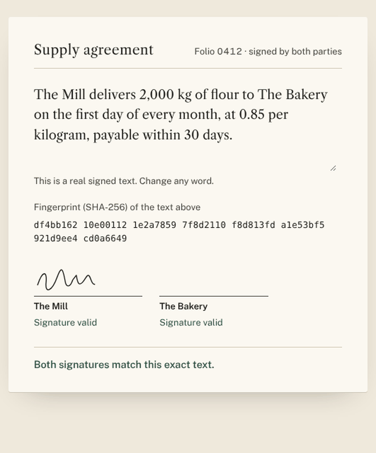</p>
<p align="center"><em>The first thing on the site: a real signed contract. Change one word and both Ed25519 signatures stop verifying, in your browser.</em></p>

| | |
|---|---|
|  |  |
| **Explainer.** The claim, a live deed, and ten numbered steps through the life of one transaction. | **Tampered.** Every changed character of the fingerprint is marked; both signatures fail. |
|  | 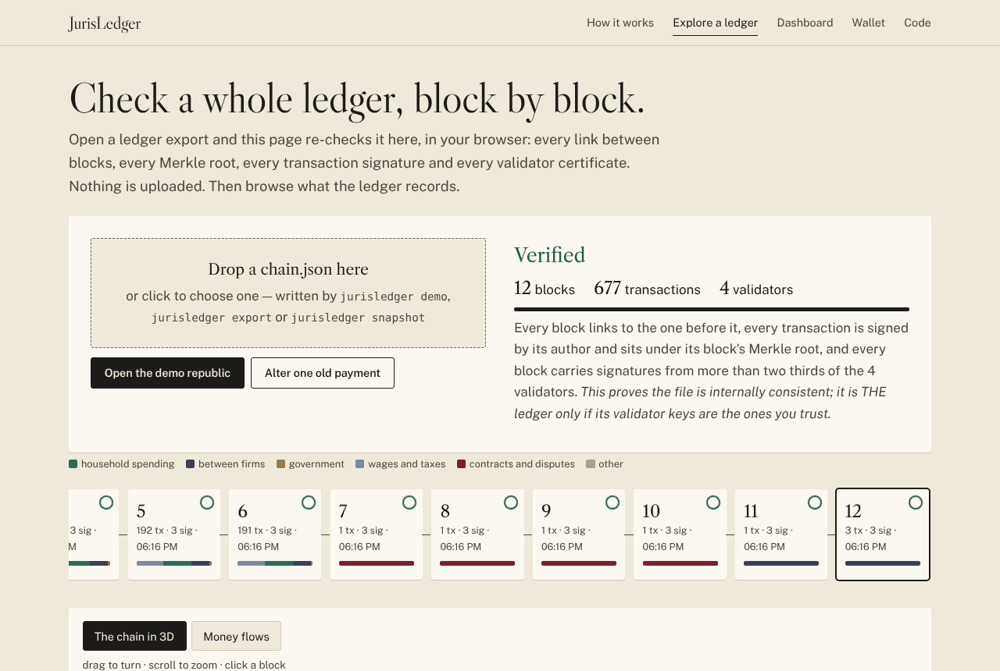 |
| **Dark mode** is the same register under a reading lamp, on every page. | **Explorer.** Drop a `chain.json` and every block is re-verified in your browser. |
|  | 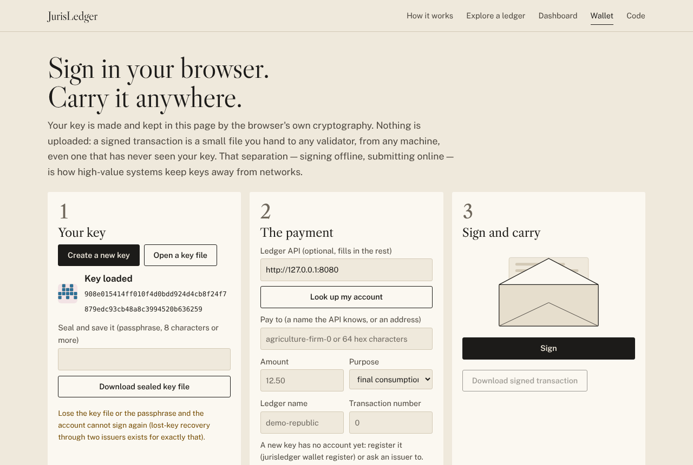 |
| **Dashboard.** Activity, spending mix, GDP and consensus health, live or from a sample. | **Wallet.** Make a key, sign a payment, carry the file to any validator. |

<p align="center">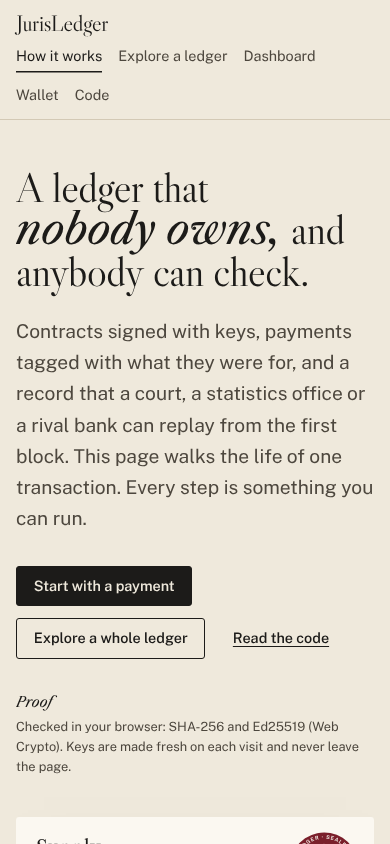</p>

## Setup and usage

You need Python 3.10 or newer. It's tested on Ubuntu, including Windows Subsystem for Linux 2 (WSL 2). The only runtime dependency is [`cryptography`](https://cryptography.io).

```bash
git clone https://github.com/Normansrule/juris-ledger.git && cd juris-ledger
python3 -m venv .venv && source .venv/bin/activate
pip install -e ".[dev]"
```

Then, in about five minutes:

```bash
jurisledger demo --out demo        # build a sample ledger; open demo/register.html in a browser
jurisledger audit demo/chain.json --genesis demo/genesis.json   # re-verify everything against a founding record you trust
jurisledger verify demo/evidence-cold-storage-lease.json demo/validators.json   # check one contract offline
jurisledger all                    # run all thirteen experiments; each claim prints PASS or FAIL
```

A few more once you're comfortable:

```bash
jurisledger snapshot demo/chain.json -o snap.json && jurisledger audit snap.json   # join or audit from a certified snapshot
jurisledger cluster --out cluster  # four validator processes over TCP: pay, kill one, restart it, watch it catch up
jurisledger fuzz --runs 50 --steps 500   # random attacks, eight invariants checked after every transaction
python -m pytest -q                # the full suite; every printed claim is also asserted
```

To use the browser tools locally, open `site/index.html` (or `explorer.html`, `dashboard.html`, `wallet.html`) straight from disk; nothing is fetched from the internet. Running validators on separate machines is covered in [`docs/DEPLOY.md`](docs/DEPLOY.md).

Here's what `jurisledger all` looks like:

```text
=== Obligations, compliance and court-ready evidence files ===
    instalment-1   due block 4  paid $500.00 of $500.00  settled at 3  -> PAID
    instalment-2   due block 6  paid $500.00 of $500.00  settled at 7  -> PAID_LATE
    instalment-3   due block 8  paid $0.00 of $500.00  settled at None  -> OVERDUE
  [PASS] an evidence file verifies offline with only the validators' public keys
=== Consensus on a hostile network: single-phase versus two-phase voting ===
  [PASS] single-phase voting FORKS under a partition, with zero dishonest validators
  [PASS] two-phase voting with locks, same adversary: all four validators finalise the same block
  ...
ALL CHECKS PASSED          (127 claims)
```

### Who uses which tool

| You are | You run | You get |
|---|---|---|
| Anyone who pays | the [wallet](https://normansrule.github.io/juris-ledger/wallet.html), then `jurisledger submit` | A key made and kept in the browser, a payment signed with nothing sent anywhere, and a signed file you carry to any validator. Signatures are byte-identical to the Python ones |
| A clerk, journalist or citizen | `register.html` from `jurisledger demo` | A browsable public register: contracts and who opened them, obligations, national accounts, review flags, and a *Verify* button on every contract. One self-contained file |
| Anyone with a ledger export | the [explorer](https://normansrule.github.io/juris-ledger/explorer.html) | Every block's links, Merkle root, signatures and certificate checked in the browser; transactions in plain sentences, one account followed across blocks, GDP up to any block, the fraud detectors, and a 3D view of the chain and of money flows |
| A lawyer, arbitrator or auditor | `jurisledger verify evidence.json validators.json`, or step 9 of the explainer | A plain-language verdict on one contract, checked offline against validator keys *you* supply. Exit code 0 or 1, so it scripts |
| A statistics office | `jurisledger index`, `query`, `metrics`, `api`, and the [dashboard](https://normansrule.github.io/juris-ledger/dashboard.html) | An incremental SQLite index, a rate-limited read-only JSON (JavaScript Object Notation) application programming interface (API), and a dashboard with the supply-and-use table and a what-if of how demand ripples through the economy. See [`docs/DATA.md`](docs/DATA.md) |
| An operator | `jurisledger init`, `jurisledger node …`, `jurisledger status HOST:PORT` | One validator process per machine; `jurisledger cluster` shows the whole choreography on one machine first |

## Ten things you can watch happen

The [explainer](https://normansrule.github.io/juris-ledger/) (also in [`site/index.html`](site/index.html)) walks the life of a single transaction. Each step maps to one experiment in this repository:

| Step | What you do on the page | The experiment that proves it |
|---|---|---|
| 1. A payment becomes final | Step a payment from Ana's phone through gossip, proposal, prevote, precommit, to a stamped seal | `jurisledger integration` |
| 2. The network is attacked | Run the same delaying attack against single-phase and two-phase voting; watch one fork and one hold | `jurisledger asynchrony` |
| 3. A contract is sealed | Edit the words of a signed agreement and watch the fingerprint and signatures react | `jurisledger contracts` |
| 4. Who is anyone | Collect attestations from independent issuers, one of them corrupt; vote it out | `jurisledger identity` |
| 5. Hidden amounts, honest books | Decompose an amount into 32 bit-commitments; try to pay a negative number | `jurisledger confidential` |
| 6. The economy, measured | Move purchases into cash and see exactly what the ledger stops seeing | `jurisledger gdp` |
| 7. Fraud, found | Inject a round-tripping ring and run the detector | `jurisledger fraud` |
| 8. Settle a dispute | Move time forward, pay or miss rent, open a dispute, issue an award, and try to make the arbitrator double the debt | `jurisledger disputes` |
| 9. Prove it to a court | Drop a real evidence file and verify every signature, certificate and Merkle path in the browser; then try four ways to cheat | `jurisledger verify`, `tests/test_site_verifier.py` |
| 10. Lock the text away | A restricted contract encrypted with a key split 3-of-5 among custodians; take custodians offline, make one lie, let two collude | `jurisledger vault`, `tests/test_vault.py` |

The question behind all of it:

> *If contracts and payments were recorded on a ledger that no single institution controls, could agreements become harder to forge and easier to prove, could fraud become harder to hide, and could a country measure its own economy more truthfully, without handing anyone a new kind of central power?*

---

## The idea in one picture

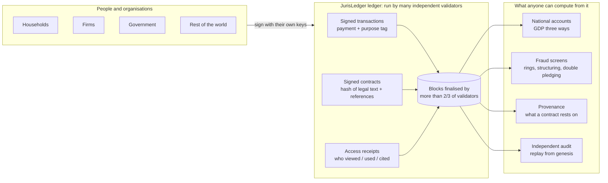

In plain words:

1. **You sign what you do.** A payment or a contract is only valid with the digital signature of the person doing it. Nobody, including the people running the ledger, can create a payment from your account.
2. **Many parties check it, none controls it.** A block of transactions becomes final only when more than two thirds of the validators have independently re-run every rule and signed it.
3. **Payments say what they are for.** Each payment carries a purpose (consumption, investment, wages, export, …). The ledger *rejects* tags that do not fit the accounts involved, so statistics come out as simple sums.
4. **Contracts are legal text plus a fingerprint.** The readable contract is stored off the ledger; its cryptographic hash, its parties, its signatures, everything it cites, and every recorded view or use are on the ledger.
5. **Anyone can replay it.** The whole history can be re-verified from the first block by a statistics office, a court, a journalist or a competitor, without asking permission.

---

## Problems and what JurisLedger tries

| Problem today | What JurisLedger does | Code | Experiment that tests it |
|---|---|---|---|
| Contracts can be back-dated, swapped or quietly altered; nobody knows who relied on which version | Ricardian contracts: signed hash of the prose, machine-readable terms, typed references, supersession instead of deletion, receipted access log | `jurisledger/contracts.py` | `python -m jurisledger contracts` |
| "Did they pay on time?" is settled by whose records the judge believes | Payment duties are machine-readable terms; payments name the obligation they discharge; status (paid, late, partial, overdue) is computed from public data for any past date | `jurisledger/legal.py`, `jurisledger/state.py` | `python -m jurisledger legal` |
| Proving a digital agreement to an outsider means trusting whoever hosts the system | An *evidence file*: the signed transactions, Merkle paths and validator certificates for one contract, verifiable offline with nothing but the validators' public keys | `jurisledger/legal.py` | `python -m jurisledger legal` |
| When parties disagree, a platform operator or nobody at all decides | The contract itself names an arbitrator the parties chose. It acts only on a party's claim, once, only on the obligations in dispute, and can only reduce, postpone or waive — never increase, never move money | `jurisledger/state.py`, `jurisledger/legal.py` | `python -m jurisledger disputes` |
| Gross Domestic Product (GDP) is estimated from surveys and tax files, arrives late and gets revised for years | Payments carry validated purpose tags; GDP by expenditure, production and income become sums that must agree | `jurisledger/stats.py`, `jurisledger/state.py` | `python -m jurisledger gdp` |
| Statistics depend on trusting one producer | Anyone can recompute every figure from the public chain | `Chain.audit`, `jurisledger/stats.py` | `gdp`, `attacks` |
| A central operator can alter, censor or invent records | Byzantine-fault-tolerant quorum; validators have narrow, checkable powers and lose their seat if caught cheating | `jurisledger/chain.py`, `jurisledger/consensus.py` | `python -m jurisledger attacks` |
| Simple voting schemes quietly assume the network is reliable | A message-level simulator with an adversary that delays anything: single-phase voting forks with *no* dishonest validator; Tendermint-style two-phase voting with locks survives the same attack and 1,000 random ones The real ledger now runs on it, with every vote signed | `jurisledger/bft.py`, `jurisledger/ledgernet.py` | `asynchrony`, `integration` |
| Validators that only exist inside one simulator prove nothing about a deployment | Each validator is a separate process with its own key file and on-disk store, speaking signed frames over TCP; a killed node restarts from its store and catches up by re-verifying certificates from peers | `jurisledger/net.py`, `jurisledger/cluster.py` | `jurisledger cluster`, `tests/test_net.py` |
| Joining or auditing a ledger years old means replaying everything | Certified snapshots: the full state after a block, checked against that block's validator certificate and `state_root`; a new validator or auditor starts there | `jurisledger/chain.py` (`from_snapshot`), `jurisledger snapshot` | `tests/test_snapshot_wallet.py` |
| Anyone can invent a thousand fake companies; one registrar is a single point of capture | Identity from *several independent issuers* (company registry, tax authority, civil registry…). Unverified accounts are capped; contracts need verified parties; validators can vote an issuer out | `jurisledger/state.py` | `python -m jurisledger identity` |
| Lose the key, lose everything — unacceptable for a public system | Owners rotate keys; lost keys are recovered by the issuers that know the person, after a waiting period in which the real owner can veto. Contracts, obligations and evidence follow the new key | `jurisledger/state.py`, `jurisledger/legal.py` | `python -m jurisledger identity` |
| Asymmetric information: each lender, buyer or regulator sees only its own slice | One shared record: a receivable pledged to two banks, or money moving in a circle, is a lookup instead of an investigation | `jurisledger/fraud.py` | `python -m jurisledger fraud` |
| A transparent ledger is a surveillance machine | Confidential balances: amounts are Pedersen commitments on Ed25519; every payment carries range proofs so nothing negative moves and nobody overspends; purposes and parties stay public so statistics can add the commitments up and verify an opened *sum* | `jurisledger/privacy.py`, `jurisledger/ec.py`, `jurisledger/state.py` | `python -m jurisledger confidential` |
| Publishing sector totals from few firms leaks who paid what | Small-cell suppression and differential privacy on released statistics (experimental; noisy at small scale) | `jurisledger/stats.py` | `python -m jurisledger privacy` |

---

## How it works

### 1. Transactions and the state machine

Every change is a signed transaction bound to a network (`chain_id`), an account and a counter (`nonce`), so it cannot be forged, replayed, or replayed on another network. `State.apply()` in [`jurisledger/state.py`](jurisledger/state.py) is the *only* code path that changes the ledger, and a failed transaction leaves no trace. Money is integer minor units; floating-point numbers are refused at serialisation.

| Transaction | What it records |
|---|---|
| `REGISTER` | A new household, firm, bank or non-resident. Government and validator identities cannot be self-declared |
| `PAYMENT` | Money moved, tagged with a purpose; optionally an invoice hash and the contract it is paid under |
| `CONTRACT_CREATE` / `CONTRACT_SIGN` | A contract's hash, terms, parties and references; each party's signature over the exact text |
| `CONTRACT_ACCESS` / `CONTRACT_GRANT` | A signed receipt that someone viewed or used a contract; permission for a third party to read a restricted one |
| `DISPUTE_OPEN` / `DISPUTE_FILE` / `DISPUTE_WITHDRAW` / `DISPUTE_AWARD` | A claim under the contract's arbitration clause, filings by hash, and the arbitrator's bounded decision |
| `SHIELD` / `CONFIDENTIAL_PAYMENT` / `UNSHIELD` | Move value into a hidden balance, pay a hidden amount (commitment + two range proofs), withdraw a revealed amount |
| `ATTEST` / `ATTEST_REVOKE` | An accredited issuer vouches for an account (credential kept off-chain, hash on-chain), or withdraws it |
| `KEY_ROTATE` / `RECOVERY_REQUEST` / `RECOVERY_VETO` / `RECOVERY_FINALIZE` | Moving an account to a new key: by its owner at once, or by its issuers after a veto window |
| `EVIDENCE` | Proof that a validator signed two different blocks at the same height |
| `VALIDATOR_VOTE` | Validators voting to add or remove a validator or an identity issuer, or to change a policy parameter (identity threshold, unverified cap, recovery delay); each needs the same two-thirds quorum |

### 2. Blocks and finality without a central authority

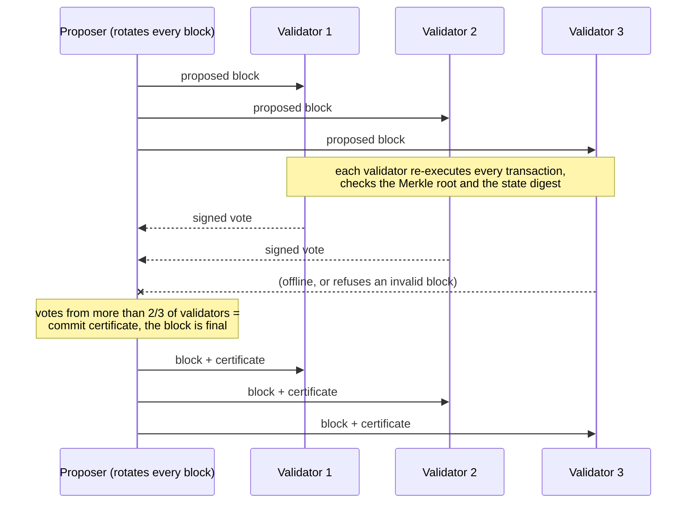

This is the family of Practical Byzantine Fault Tolerance (PBFT) and Tendermint. With `n` validators, safety holds while fewer than one third misbehave. The validators could be, for example, a central bank, a statistics office, a court administration, commercial banks, universities and a civil-society auditor — chosen so that no single interest holds a third of the seats.

**Limited powers by design.** A validator can order valid transactions and delay them briefly. It cannot spend from an account, alter a contract, change a purpose tag, or finalise a block alone, because honest validators will not sign such a block and outsiders will not accept a block without a certificate.

### 3. Why two phases: consensus on a hostile network

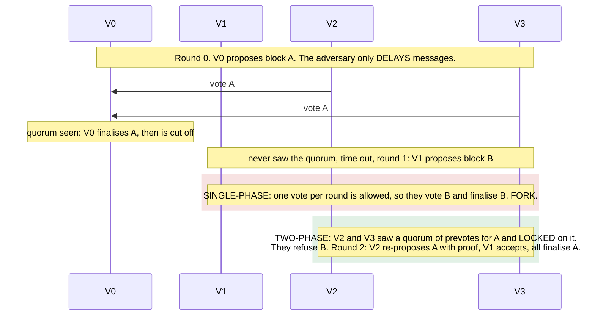

`jurisledger/bft.py` runs both protocols over the *same* adversarial scheduler, and `jurisledger/ledgernet.py` drives the real chain with the two-phase one: proposals carry blocks, every vote is signed and checked, and a quorum of signed precommits is the block's certificate. The adversary forges nothing and drops nothing; it only chooses when messages arrive. That is enough to fork single-phase voting with four honest validators. The fix is the lock: any two quorums share an honest validator, and a locked validator will not help finalise a rival block. The experiment also shows the limit honestly: with two of four validators colluding, even two-phase voting forks, but every honest validator ends up holding the colluders' conflicting signatures, so the guilty are provable.

### 4. Contracts that are legal documents *and* data

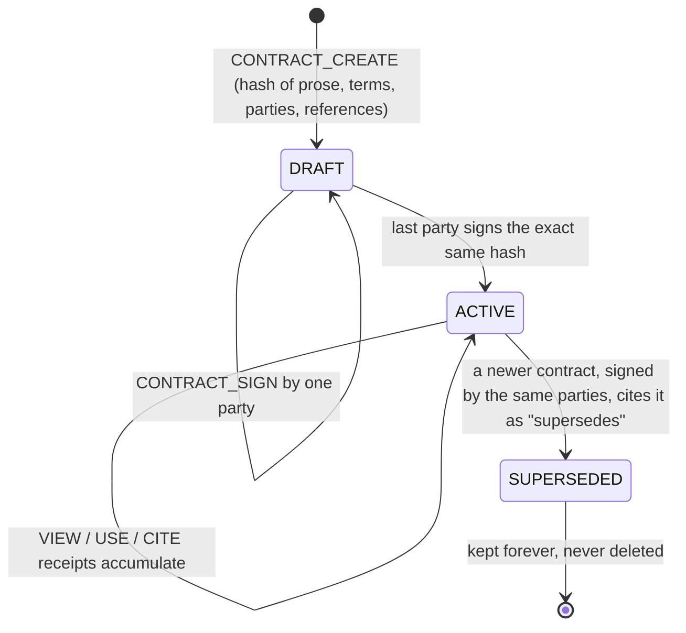

Following Ian Grigg's *Ricardian contract*, the human-readable text stays off the ledger in a `ContractVault`; the ledger holds its SHA-256 hash. The vault hands out text only in exchange for a finalised, signed `CONTRACT_ACCESS` receipt, one receipt per read. That is how "who viewed it" becomes a fact instead of a server log someone can edit. References are typed (`cites`, `implements`, `amends`, `supersedes`) and can point to other contracts or to any external document by hash — a statute, a technical standard, an invoice.

### 5. Obligations and evidence a third party can check

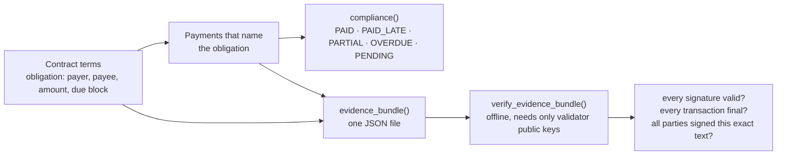

The evidence file is the bridge to the existing legal system. An arbitrator does not need an account, a node, or trust in either party: the file either verifies against the published validator keys or it does not. Its limit is stated in the code and tested: a file proves what happened, never that nothing else happened. See [`docs/LEGAL.md`](docs/LEGAL.md).

### 6. Disputes: a referee with a short list of powers

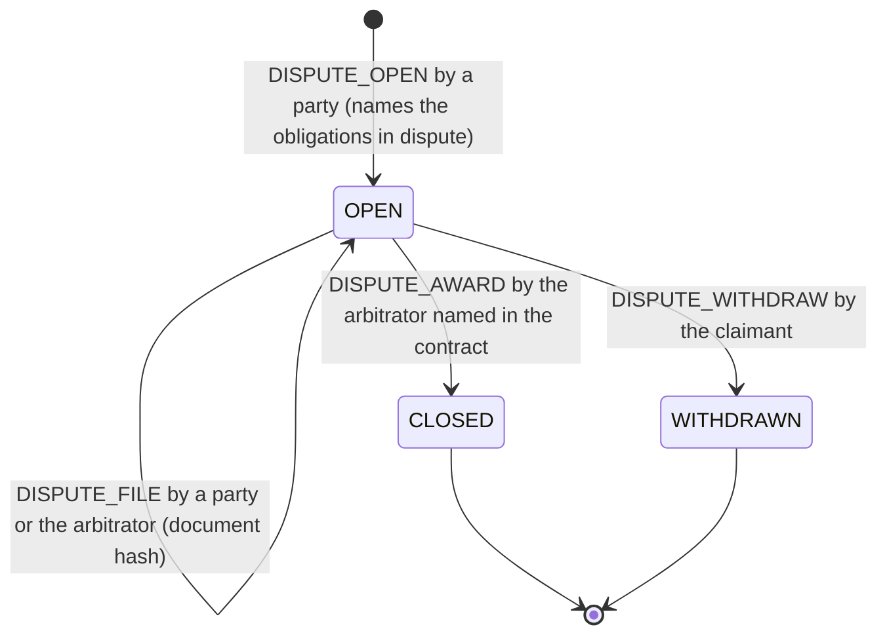

The same "limited action" principle that binds validators binds the arbitrator. It is chosen by the parties inside the contract they all signed, may read a restricted contract (leaving a receipt like anyone else), and its award can only **reduce, postpone or waive** an obligation that is actually in dispute. While a dispute is open the obligation shows as `DISPUTED`, not `OVERDUE`. The ledger never seizes funds: after the award the debtor still pays with its own signature, and if it does not, the record says `OVERDUE` and the evidence file goes to a court.

### 7. Identity and keys for a public system

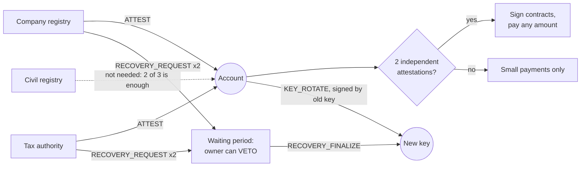

No single registrar decides who exists. Credentials stay off-chain with the issuer; only their hash is public. The same rule protects against a captured issuer in both directions: one corrupt issuer cannot create usable fake firms, and two colluding issuers who try to seize an account are stopped by the owner's veto during the waiting period.

### 8. National accounts as a by-product

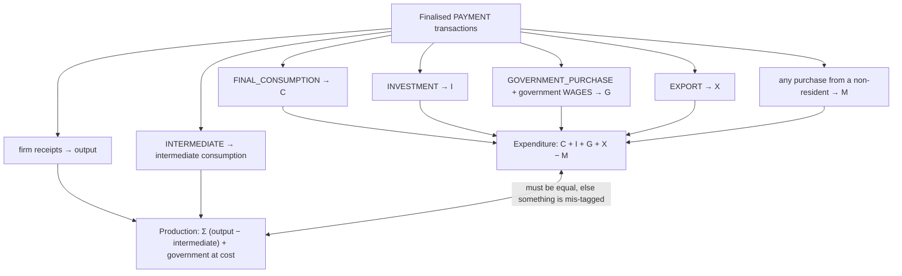

The two totals come from different transactions, so their agreement is a genuine check. A hand-computed example lives in [`tests/test_stats_privacy.py`](tests/test_stats_privacy.py).

### 9. Fraud: prevented versus detected

| Made impossible by the protocol | Flagged for human review by `jurisledger/fraud.py` |
|---|---|
| Forged payments, replayed payments, double spending | Circular flows (round-tripping, wash trades, carousel tax fraud) |
| Altered or back-dated contracts, signing a different text | Structuring just under a reporting threshold |
| Mis-declared statistics tags (a household "government purchase") | Invented figures that fail Benford's first-digit law |
| Rewriting history | The same receivable pledged to several lenders |

The detectors report their false positives too; the experiment prints the flags raised on a *clean* economy before any fraud is injected.

---

## Who can attack it, and how far they get

| Adversary | Can do | Cannot do | Shown by |
|---|---|---|---|
| Outsider with no keys | Read public data, submit junk that is ignored | Move anyone's money, vote, register as government | `attacks` b, e |
| Account holder | Lie about *why* a payment was made within the tags its role allows | Overspend, replay, use tags reserved for other roles | `attacks` c, d, e |
| One malicious validator | Delay a victim's transaction by about one block; waste a round | Forge, censor permanently, fork honest nodes; equivocation costs it its seat | `attacks` b, f, g |
| Up to one third of validators offline | Slow the chain | Stop it | `attacks` h |
| One third or more refusing to vote | Halt the chain | Corrupt it — nothing false is ever finalised | `attacks` h |
| Someone on the wire | Delay or cut connections | Read traffic (TLS 1.3), impersonate a validator (certificate pinned to its key, challenge signed), inject consensus traffic without a validator key, exhaust the listener beyond its cap | `test_net.py` |
| The network itself (delays, partitions, reordering) | Stall progress while the partition lasts; fork *single-phase* voting | Fork two-phase voting; forge or alter any message | `asynchrony` |
| One third or more of validators colluding | Fork even two-phase voting among cut-off honest validators | Do it deniably: their conflicting signatures convict them | `asynchrony` |
| Two thirds or more colluding | Finalise an invalid block among themselves | Make any honest auditor accept it: replay from genesis fails | `Chain.audit` |
| Holder of a hidden balance | Hide amounts from everyone | Pay a negative amount, overspend, replay, or hide from the statistics *sum*; use hidden balances without a verified identity | `confidential` |
| Creator of fake identities (Sybil attack) | Register any number of accounts for free | Sign a contract or move more than the cap without *k* independent issuers | `identity` |
| One corrupt identity issuer | Attest anyone; request recoveries | Make an account verified alone; seize an account (needs *k* issuers *and* the owner's silence through the veto window); survive a validator vote | `identity` |
| The arbitrator named in a contract | Reduce, postpone or waive a disputed obligation; read the contract (receipted) | Act without a party's claim, decide twice, increase a debt, touch undisputed terms, move money | `disputes` |
| Whoever stores the contract text | Refuse to serve it | Alter it undetected, or serve it without a receipt being owed | `contracts` |

Full treatment, including what is *not* defended: [`docs/THREAT_MODEL.md`](docs/THREAT_MODEL.md).

---

## What this does not solve

Stated plainly, because a framework that hides its gaps is a sales brochure.

1. **Off-ledger activity is invisible.** With 30 % of purchases in cash, the ledger captured 87 % of true GDP in our simulation. The ledger measures what is on it, exactly — not the economy, exactly.
2. **Honest-looking lies.** The protocol checks that a tag fits the *roles* involved, not that a firm's "investment" really was a machine and not a yacht. Cross-checks narrow this; they do not close it.
3. **Identity is a framework, not a solution.** The ledger enforces *k-of-n independent issuers*, revocation, recovery and governance over issuers. Whether the issuers check documents properly is outside the code, and if *k* issuers collude against an owner who is not watching during the veto window, they win.
4. **Privacy is real but heavy, and partial.** Hidden amounts with range proofs work on the ledger (`confidential`) and the opening now travels encrypted inside the transaction, but each payment costs about 22 kB and half a second in pure Python, and payers, payees and purposes remain public. Bulletproofs and hidden counterparties are roadmap items.
5. **Networking is real; deployment hardening is not finished.** Validators run as processes over Transport Layer Security (TLS) 1.3 with each certificate pinned to the validator's own key, peers prove their identity by signing a challenge, and inbound connections are capped. Not done: peer discovery, rate limiting by source, and running across real network distances. Timers are coarse; nothing here is a latency claim.
6. **Law.** Electronic signatures have legal effect in many places (the United States ESIGN Act and Uniform Electronic Transactions Act, the European Union eIDAS Regulation), but a permanent ledger sits uneasily with data-erasure rights. That is why JurisLedger keeps prose and personal data off-chain. Whether a tribunal admits an evidence file is a question for that tribunal. None of this is legal advice.
7. **Performance is a prototype's.** Pure Python validates roughly seven thousand transactions per second per core (`jurisledger bench`); that is enough to study the design and not a production figure in either direction.
8. **National accounts are harder than this.** No inventories, depreciation, imputed rents or financial-intermediation services. See [`docs/ECONOMICS.md`](docs/ECONOMICS.md).

---

## Project structure

```text
juris-ledger/
├── jurisledger/          the Python package
│   ├── crypto.py         canonical JSON, SHA-256, Ed25519, Merkle tree with inclusion proofs
│   ├── tx.py             signed transactions, strict parsing
│   ├── block.py          headers, blocks, the vote message
│   ├── state.py          the state machine: every validation rule lives here
│   ├── chain.py          block validation, commit certificates, full audit, snapshots, light-client proofs
│   ├── consensus.py      validator nodes, simulated network, Byzantine behaviours, mempool
│   ├── bft.py            hostile-network laboratory: single-phase versus two-phase voting
│   ├── ledgernet.py      the real chain on signed two-phase consensus; block sync; equivocation evidence
│   ├── signguard.py      durable signing journal: a validator never signs twice
│   ├── net.py            validators as processes: TLS 1.3 transport with key pinning, peer challenge, catch-up
│   ├── cluster.py        launches N node processes locally and exercises them (pay, kill, rejoin)
│   ├── storage.py        durable append-only block store, anchors, pruning to a certified snapshot
│   ├── contracts.py      wallet helpers, contract vault, audit trail, provenance tree
│   ├── legal.py          obligations, compliance, disputes, offline-verifiable evidence files
│   ├── vault.py          threshold-encrypted contract vault (AES-256-GCM, Shamir k-of-n with Feldman commitments)
│   ├── keystore.py       key files sealed with a passphrase (scrypt + AES-256-GCM)
│   ├── privacy.py, ec.py Pedersen commitments, range proofs, Ed25519 point arithmetic
│   ├── stats.py          GDP three ways, differentially private release
│   ├── accounts.py       supply-and-use tables, value added by industry, Leontief inverse
│   ├── fraud.py          four fraud detectors
│   ├── index.py, api.py  incremental SQLite index and the read-only JSON API
│   ├── wallet.py         command-line wallet against a running validator
│   ├── deploy.py         `jurisledger init`: genesis, peers, per-machine key folders
│   ├── dashboard.py      the self-contained public register
│   ├── demo.py           sample ledger, evidence file and register for first contact
│   ├── sim.py            synthetic economy with independent ground truth
│   ├── experiments.py    the thirteen experiments; every claim is a checked boolean
│   ├── fuzz.py           invariant fuzzing
│   └── bench.py, doctor.py   honest performance numbers; environment checks
├── site/                 the browser tools (deployed to GitHub Pages by .github/workflows/pages.yml)
│   ├── index.html        the interactive explainer
│   ├── explorer.html     ledger explorer, with ledger3d.js for the 3D views
│   ├── dashboard.html    statistics and operations dashboard
│   ├── wallet.html       browser wallet (wallet.js)
│   ├── hero.js           the explainer's live deed (SHA-256 and Ed25519 through Web Crypto)
│   ├── verify.js         evidence verifier, ledger audit, GDP and fraud detectors in JavaScript
│   ├── safe.js           the escaping template every dynamic page fragment goes through
│   ├── style.css         the shared visual system: tokens, type, motion (see Design, below)
│   └── fonts/            Libre Caslon and Public Sans, self-hosted, with their licence (OFL.txt)
├── tools/                audit_repro.py, csp.py, a11y_audit.py, manifest.py
├── tests/                the test suite; vectors/canonical.json is the Python and JavaScript contract
├── docs/                 security findings, threat model, architecture, legal, economics, experiments, screenshots
├── assets/banner.svg     the animated README banner
└── examples/quickstart.py
```

## Design

The site and the browser tools share one visual system, **The Register**: the court's bound record book. The project's strongest claim is that anybody can check the record, so the pages are designed to feel like a certified folio you could hand to a judge, not like a trading terminal or a crypto dashboard.

**Colour: paper, ink and two stamps.** Warm ledger paper (`#EFE9DC`), iron-gall ink (`#1C1B19`), an oxblood seal (`#7A1F2B`) and one verified green (`#1F5E4A`). Oxblood is the brand mark and anything that breaks; green only ever means "this checks out"; amber only ever means "pending". Dark mode is the same book under a reading lamp: umber paper and parchment ink, not an inverted palette. Chart categories have their own tokens, so the dashboard and explorer read correctly in both modes.

**Type: law-report serif, public-service sans.** Libre Caslon (the face of printed law reports) for headings and figures, Public Sans (the United States government's open typeface) for reading and interface, monospace only for hashes and commands. Both are self-hosted, so no page talks to a font service. Numbers use tabular figures.

**Layout: a folio with margins.** Each of the ten steps is a numbered paragraph (¶ 1 to ¶ 10). The paragraph mark sits in the left margin, the claim and the interactive "stage" sit in the text column, and the right margin carries a *Proof* citation: the command in this repository that checks the same claim. Surfaces are separated by a step in paper tone instead of boxes and hairlines.

**Motion: ink and press.** Signatures draw on as a pen stroke, and the seal presses with a short spring (a damped-spring curve written as CSS `linear()`, so it runs on the compositor). Buttons give a 140-millisecond press. Nothing a reader repeats often is animated. With `prefers-reduced-motion`, nothing travels: signatures appear already written and the seal fades in already pressed, but colour still changes so you can see what happened.

**The hero moment.** The first screen is a real two-party contract. The page signs its SHA-256 fingerprint with two fresh Ed25519 keys through the browser's Web Crypto interface. Every keystroke re-hashes and re-verifies, the changed hex characters are marked, the signatures are struck through, and the seal cracks. One button puts the original back. If a browser has no Ed25519, the page says so and compares fingerprints only, instead of claiming a check it did not do.

**Principles we hold to.**
- No decoration standing in for content: no gradients, glass, glows, icon-card grids or stock illustrations.
- States are designed: an empty explorer says what to open, loading shows real progress, and errors name the problem in plain words.
- Untrusted data is always rendered as text and labelled unverified. Pages run under a hash-based Content Security Policy (CSP).
- Accessibility is a gate, not a goal. The axe-core audit against the Web Content Accessibility Guidelines (WCAG) 2.1 A and AA, in light and dark, must report 0 problems (see [`docs/ACCESSIBILITY.md`](docs/ACCESSIBILITY.md)). Every control is reachable by keyboard and has a visible focus ring.

All tokens (colour, type scale, spacing, easing, durations) sit at the top of [`site/style.css`](site/style.css), so a change of direction happens in one place.

## Documentation

| Document | Contents |
|---|---|
| [`SECURITY.md`](SECURITY.md) | Status, how to report a vulnerability, what the audit found and the production-readiness decision |
| [`docs/SECURITY_FINDINGS.md`](docs/SECURITY_FINDINGS.md) | Every audit finding: status, files, regression test, before/after evidence, remaining risk |
| [`docs/CANONICAL.md`](docs/CANONICAL.md) | The canonical JSON contract every implementation must follow (with test vectors) |
| [`docs/ACCESSIBILITY.md`](docs/ACCESSIBILITY.md) | WCAG 2.1 AA: the automated audit of every page (0 problems), what it fixed, what it cannot check |
| [`docs/DATA.md`](docs/DATA.md) | The SQLite index: commands, tables, why it can be trusted, measured speed |
| [`docs/DEPLOY.md`](docs/DEPLOY.md) | Running validators on separate machines: `jurisledger init`, per-machine folders, operations, a two-machine exercise |
| [`docs/GOVERNMENT.md`](docs/GOVERNMENT.md) | Blueprint for public-sector use: who validates, who issues identity, phased rollout, capacity, what must exist outside the code |
| [`docs/LEGAL.md`](docs/LEGAL.md) | How the design maps to contract and evidence law concepts; what a lawyer should question |
| [`docs/ARCHITECTURE.md`](docs/ARCHITECTURE.md) | Data structures, validation rules, design decisions and the alternatives rejected |
| [`docs/THREAT_MODEL.md`](docs/THREAT_MODEL.md) | Adversaries, guarantees, non-guarantees |
| [`docs/ECONOMICS.md`](docs/ECONOMICS.md) | Asymmetric information, national-accounts mapping, simplifications |
| [`docs/EXPERIMENTS.md`](docs/EXPERIMENTS.md) | Each experiment: hypothesis, method, result, what it does not show; ideas to try next |
| [`docs/REFERENCES.md`](docs/REFERENCES.md) | Annotated bibliography: what each source contributed |
| [`docs/ROADMAP.md`](docs/ROADMAP.md) | From prototype toward something deployable |

## Licence

MIT — see [`LICENSE`](LICENSE).
